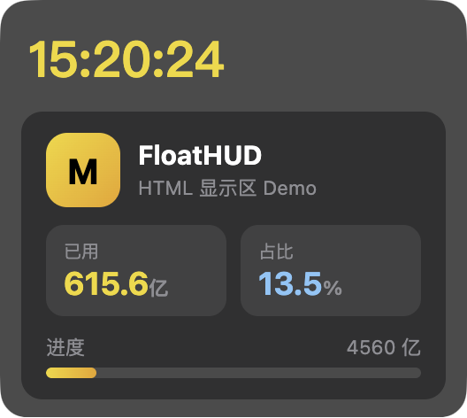

# FloatHUD

跨平台置顶悬浮 HUD：数据源可配、模板可配、样式可配。像 xbar，但是浮在桌面上（含全屏应用之上）。



## 特性

- **数据源可配**：`http`（JSON + `{{path}}` 模板）或 `script`（命令 stdout）
- **多行 widget**：每行独立颜色、字号、字体、刷新间隔
- **样式可调**：全局字体、卡片背景透明度
- **鼠标穿透**：点击可落到下层窗口；托盘一键切换
- **位置自动记住**：拖到哪下次就在哪；也可「固定位置」锁住不可拖
- **置顶浮窗**：无边框、不抢焦点；macOS 可压在全屏应用上
- **托盘菜单**：刷新 / 编辑配置 / 穿透 / 锁定 / 退出
- **配置热更新**：改 `config.json` 自动生效

## 安装（开发）

```bash
npm install
ELECTRON_MIRROR=https://npmmirror.com/mirrors/electron/ node node_modules/electron/install.js
npm start
```

## 配置

**推荐：图形界面**——托盘菜单 →「设置…」，改完点「保存」立即生效。也可用命令：

```bash
open -a TextEdit ~/.float-hud/config.json
```

路径：`~/.float-hud/config.json`（可用环境变量 `FLOAT_HUD_CONFIG_DIR` 覆盖目录）

```json
{
  "opacity": 0.88,
  "backgroundOpacity": 0.88,
  "fontFamily": "PingFang SC, sans-serif",
  "clickThrough": false,
  "lockPosition": false,
  "refreshSeconds": 30,
  "widgets": [
    {
      "name": "clock",
      "type": "script",
      "command": "date '+%H:%M:%S'",
      "template": "{{stdout}}",
      "color": "#FFD60A",
      "fontFamily": "Menlo, monospace",
      "fontSize": 36,
      "intervalSeconds": 5
    }
  ]
}
```

| 字段 | 说明 |
|------|------|
| `opacity` / `backgroundOpacity` | 卡片背景透明度 0–1（`backgroundOpacity` 优先） |
| `fontFamily` | 全局字体；widget 可再覆盖 |
| `clickThrough` | `true` 鼠标穿透（托盘可切换） |
| `lockPosition` | `true` 锁定位置不可拖（托盘可切换） |
| `type` | `http` \| `script` |
| `url` / `headers` | `http` 源 |
| `command` | `script` 源，stdout 为纯文本，或 JSON（可被 `{{path}}` 引用） |
| `template` | `{{json.path}}` / `{{stdout}}` 占位替换 |
| `color` / `fontSize` / `fontFamily` | 行样式 |
| `intervalSeconds` | 该行刷新间隔；缺省用全局 `refreshSeconds` |

窗口位置不用配：拖到哪里，下次启动自动回到那里（记在 `state.json`）。

## 打包分发

```bash
npm run pack:mac     # dmg
npm run pack:win     # nsis
npm run pack:linux   # AppImage
```

## 平台状态

| 平台 | 状态 |
|------|------|
| macOS | 已验证（置顶 + 全屏之上 + 拖动） |
| Windows | 未实测；`alwaysOnTop` 可用，全屏游戏独占模式可能盖不住 |
| Linux | 未实测；X11 一般可用，Wayland 合成器限制多，可能需 layer-shell 扩展 |

## 安全说明

`script` 类型会以当前用户权限执行本地命令，**只加载你自己的配置**。分发给他人时请提醒用户不要粘贴来路不明的配置。

## 依赖

- Node 18+（开发）
- 打包产物不依赖 Node

## 商业版本

| 版本 | 显示区 |
|------|--------|
| 免费版 | 仅 1 个 |
| 完整版 | 数量不限，可自定义排版 |

## License

[GPL-3.0](LICENSE) © zhangbro

分发、修改、再发布须遵守 GPL-3.0（含衍生作品开源义务）。商业授权请联系作者。
